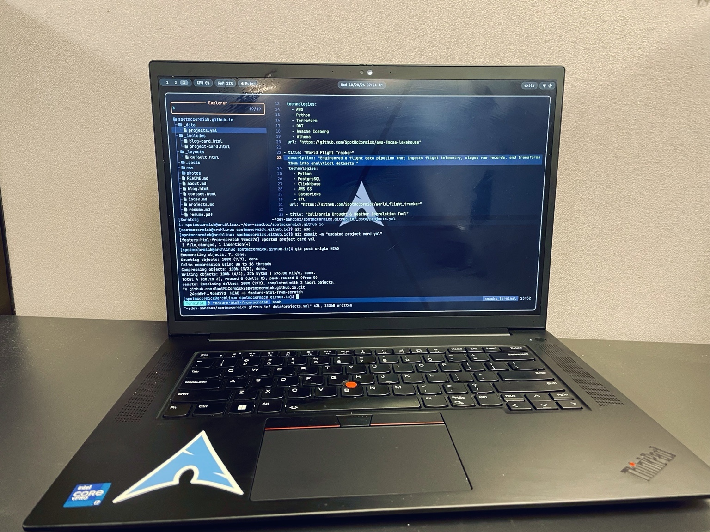

<h2 align="center">Why I Switched to Linux Desktop</h2>

    

     

    I was a Apple stan for the longest time. Right after high school graduation I knew i needed to laptop since i was heading to college. In high school I was a band kid in the drum line and at the time I wanted to study music. At the time I felt Apple was marketing their products for music types. My older brother had one, my music mentor had one, so naturally I was like  "Well, I want to get one." I remember working and saving enough money and walking into best buy. There she was, one of those black apple Macbooks. I remember best buy started carry apple products. Before that you could only get them in the apple store. I felt like I was on top of the world and ready to tackle college. 

    That laptop lived in my backpack all the way up to my all the way until my junior year. Once I decided to make the move to Nashville. I packed up that same laptop and moved across the country. It was with the laptop i learned Logic Pro, Final Cut Pro, and many other things music folks needed. I was fortunate to do a lot of music work for a decade and Macbooks helped power by business. Due to the covid pandemic I knew that it was time for me to pivot out of music work and start a new. 

    In the midst of trying to navigate a global pandemic with a family, a career switch, and a move to a different state, I stumbled upon data analytics. I did a course and my interest was piqued. I had no clue all the fun things you could do with excel, sql, and programming in general. I felt liked it paralleled mucic work that I was doing on a Macbook. I was creating things and solving problems which was something I realized why I enjoyed doing music. Getting a little taste of just doing analytics stuff I decided to enroll in a data analytics boot came.

    In 2023 I enrolled in Nashville Software School's data analytics program. I was still using a MacBook at the time. It was an intel Macbook and I it was pretty old. I was going to get a new Macbook but it was time Apple Scilicon came out. The program required either a Windows PC or a Mac but you had to set up a virtual machine. I thought to myself that I really just wanted to learn and not set up anything. I knew I wanted to work for a business and  

