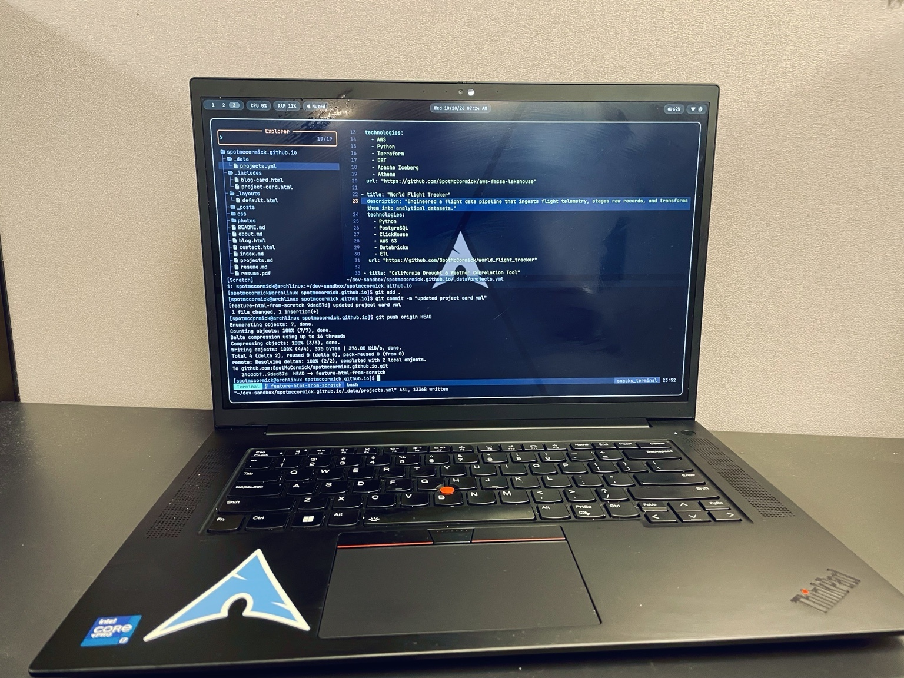

<h2 align="center">Why I Switched to Linux Desktop</h2>

     

    I was an Apple stan for the longest time. Right after high school graduation, I knew I needed a laptop since I was heading to college. In high school I was a band kid in the drumline, and at the time I wanted to study music. I felt Apple was marketing their products to music types. My older brother had one, my music mentor had one, so naturally I was like, "Well, I want to get one." I remember working and saving enough money and walking into Best Buy. There she was, one of those black Apple MacBooks. I remember Best Buy had just started carrying Apple products; before that, you could only get them in the Apple Store. I felt like I was on top of the world and ready to tackle college.

    That laptop lived in my backpack all the way until my junior year, when I decided to make the move to Nashville. I packed up that same laptop and moved across the country. It was on that laptop that I learned Logic Pro, Final Cut Pro, and many other things music folks needed. I was fortunate to do a lot of music work for a decade, and MacBooks helped power my business. Due to the COVID pandemic, I knew it was time for me to pivot out of music work and start anew.

    In the midst of trying to navigate a global pandemic with a family, a career switch, and a move to a different state, I stumbled upon data analytics. I took a course and my interest was piqued. I had no clue about all the fun things you could do with Excel, SQL, and programming in general. I felt like it paralleled the music work I was doing on a MacBook. I was creating things and solving problems, which I realized was why I enjoyed music. After getting a little taste of analytics, I decided to enroll in a data analytics boot camp.

    In 2023 I enrolled in Nashville Software School's data analytics program. I was still using a MacBook at the time. It was an Intel MacBook and it was pretty old. I was going to get a new MacBook, but it was right when Apple Silicon came out. The program required either a Windows PC or a Mac with a virtual machine set up. I thought to myself that I really just wanted to learn and not set up anything. I knew I wanted to work for a business and would probably end up using Microsoft products, so I bit the bullet and got a Windows machine.

    The program went great and I was able to find a job. They were a Windows shop, and I got a lot of reps doing data analytics work. At the time, that role required a lot of data engineering work. Diving into that kind of work, I knew I wanted to learn more data engineering skills. I was able to find an after-hours contract job as a data engineer, separate from my normal job. That company did not use Windows. They were a Mac and Linux shop. I remember my first week there my manager said, "I've never done any development in Windows. Have you thought of Linux?"

    Coming from the music world and then a few years in the business world, I got a little taste of both operating systems. I honestly hated Windows. The look and feel of it. I remember trying to get Docker and Airflow working on it and it was so painful. I couldn't take it. I know developers use Mac, but honestly I didn't want to buy back into the Mac ecosystem. Paying a ton of money for a base machine didn't sound very fun. I felt like hardware-wise you got more bang for your buck on a Windows machine. I felt like those were my only two options. It wasn't until my manager's comment that I realized there was a third option... Linux.

    I remember going over distros and picking one. We settled on Fedora. We installed it on my laptop, and I remember it booted and got to the desktop. I thought to myself, "This is real nice." The file manager reminded me a lot of Mac, as did the dock. It was a familiar environment. I cloned one of my projects from Git that I had to get Airflow up and going on, and it was so easy. I was thinking to myself, "Wow! Why didn't I do this sooner?"
    From that moment on, I was bought in. You're telling me I have a Windows laptop that is half the price of a Mac and an operating system I like being on that's not Windows 11? Sign me up.

    Things have changed a lot since then. I have distro hopped a ton and spent hours configuring things. It may sound like a horrible way to spend time, but I think it's fun, working on a machine that's specific to me and a joy to be on. I feel like I found the holy grail. I'm fully bought in. It was through this journey that I ended up on Arch Linux with Hyprland. I configured it to my liking and wouldn't want to use anything else.

